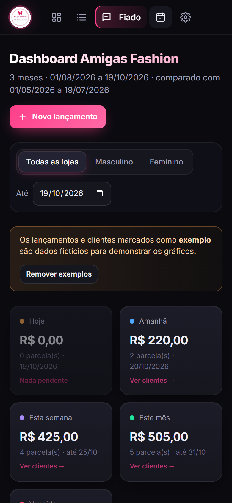

# Painel Amigas Fashion

Painel financeiro para uma loja de roupas real. Ele substituiu o caderno de anotações: registra vendas, saídas, vendas no fiado parceladas e contas a pagar, e mostra gráficos com a situação do caixa.

Funciona na rede Wi-Fi da loja. Um computador roda o servidor, e os celulares e outros computadores acessam pelo navegador, sem instalar nada.


## Telas

> Todas as imagens usam dados fictícios.

### Dashboard completo

Indicadores do período, planejamento financeiro, fluxo de caixa, meta do mês, margem de lucro, formas de pagamento e rankings de clientes.

<details>
<summary>Ver o dashboard inteiro</summary>


</details>

### Fiado

Parcelas a receber por cliente, com vencimentos de hoje, da semana e do mês, além das atrasadas.


### Lançamentos

Histórico de vendas, saídas e pagamentos, com filtros e exportação para Excel (CSV).


### Contas a pagar


### No celular

<p>
  
  &nbsp;
  
</p>

### Login


## Funcionalidades

- **Lançamentos**: vendas (dinheiro, Pix, cartão), saídas por categoria e vales de funcionárias.
- **Fiado**: vendas parceladas por cliente, com controle de parcelas pagas, em aberto e atrasadas, e WhatsApp da cliente.
- **Contas e lojas**: saldo por conta (Mercado Pago, banco digital, maquininha) e por loja (feminino/masculino).
- **Contas a pagar** e **meta mensal**.
- **Gráficos e indicadores** do período, feitos com Chart.js.
- **Login** com usuário e senha (senha com hash e sessão por cookie).
- **Nada se perde**: banco SQLite em modo WAL, histórico de toda alteração e exclusão (tabela `eventos`), lixeira com restauração e backups diários (`.db` + `.json`) mantidos por 60 dias.
- **Exportação para Machine Learning**: CSV pelo painel e visões SQL (`vw_lancamentos`, `vw_parcelas`, `vw_contas_pagar`) para pandas e Power BI.
- Pode ser instalado na tela inicial do celular, como um app.

## Tecnologias

- **Back-end:** Python 3, só com a biblioteca padrão (`http.server`, `sqlite3`), sem dependências externas.
- **Front-end:** HTML, CSS e JavaScript puro, em um único arquivo (`index.html`).
- **Banco de dados:** SQLite.
- **Gráficos:** [Chart.js](https://www.chartjs.org/).

## Como rodar

Requer Python 3.8 ou mais novo.

```bash
python servidor.py
```

Na primeira execução, o servidor pede para criar um usuário e uma senha. Depois, abra http://localhost:8080.

Atalhos: `iniciar-windows.bat` (Windows) e `iniciar-mac-linux.sh` (Mac/Linux). O passo a passo completo para a loja está em [LEIA-ME.txt](LEIA-ME.txt).

## Dados de exemplo

O arquivo `dados-iniciais.json` tem lançamentos e clientes **fictícios**, para demonstrar o painel. Ele só é carregado quando o banco está vazio. Os dados reais da loja não fazem parte deste repositório.
