# Painel Amigas Fashion

Sistema de gestão para uma loja de roupas real, com duas lojas (feminina e masculina). Ele substituiu o caderno de anotações: tem PDV para vender no balcão, estoque com etiquetas, vendas no fiado parceladas, cadastro de clientes, contas a pagar, fechamento do mês e análises, além de gráficos com a situação do caixa.

Funciona na rede Wi-Fi da loja. Um computador roda o servidor, e os celulares e outros computadores acessam pelo navegador, sem instalar nada.

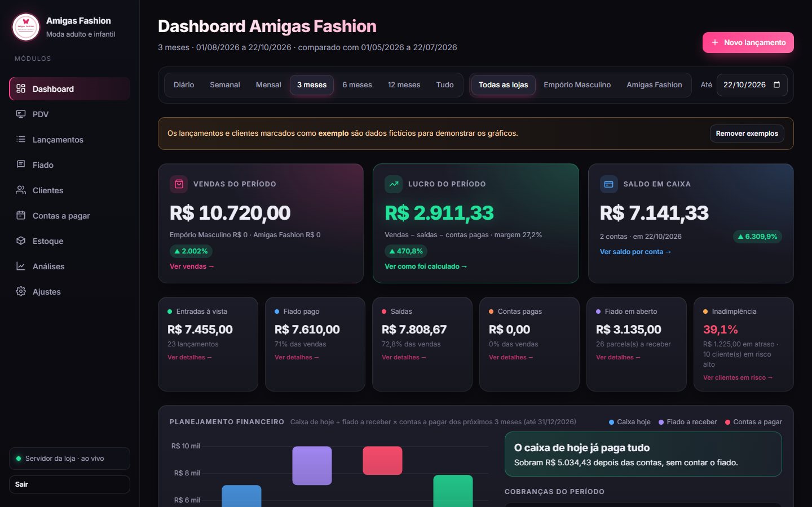

## Telas

> Todas as imagens usam dados fictícios.

### Dashboard completo

Indicadores do período, planejamento financeiro, fluxo de caixa, meta do mês, margem de lucro, formas de pagamento e rankings de clientes.

<details>
<summary>Ver o dashboard inteiro</summary>

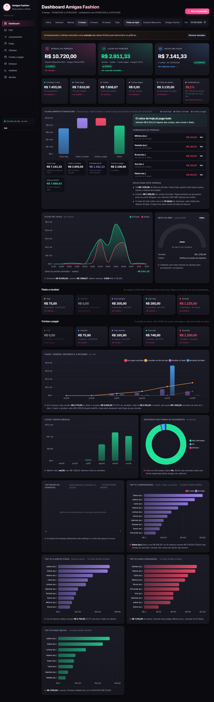

</details>

### PDV (venda no balcão)

Venda por nome da peça ou código da etiqueta, desconto, pagamento dividido em várias formas (dinheiro, Pix, débito, crédito, fiado, vale-troca) e baixa automática no estoque.

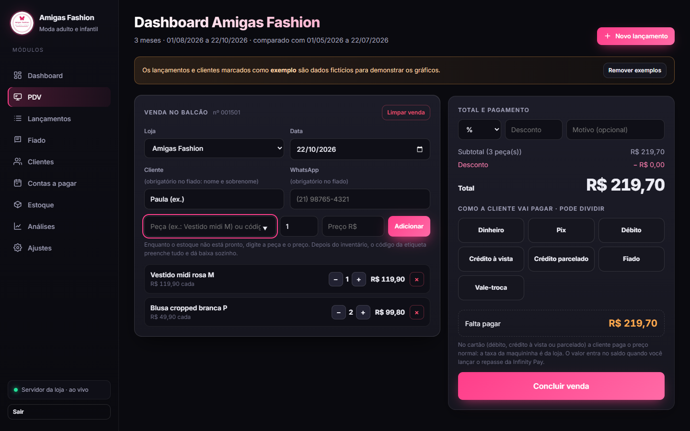

### Estoque

Peças com código de etiqueta por loja, custo, preço de venda, margem e valor parado. Gera etiqueta para imprimir e exporta para Excel.

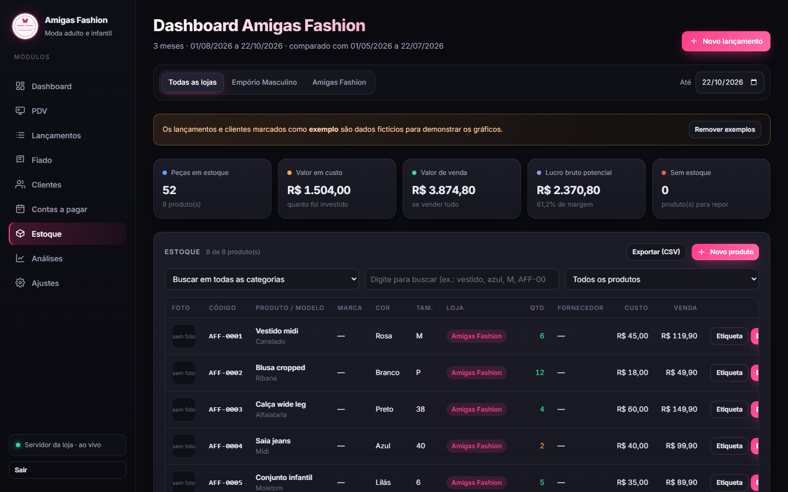

### Fiado

Parcelas a receber por cliente, com vencimentos de hoje, da semana e do mês, além das atrasadas.

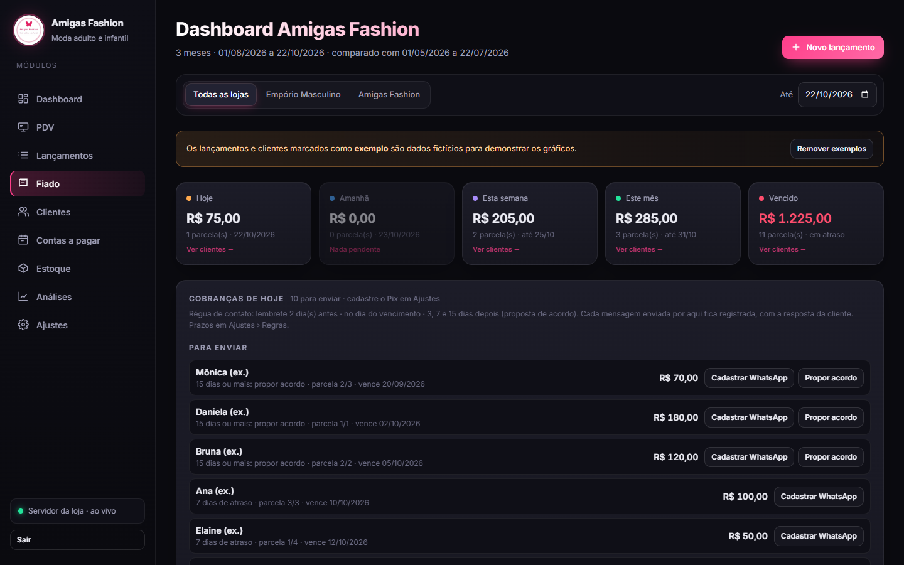

### Clientes

Cadastro com WhatsApp, número de compras, última compra e fiado em aberto.

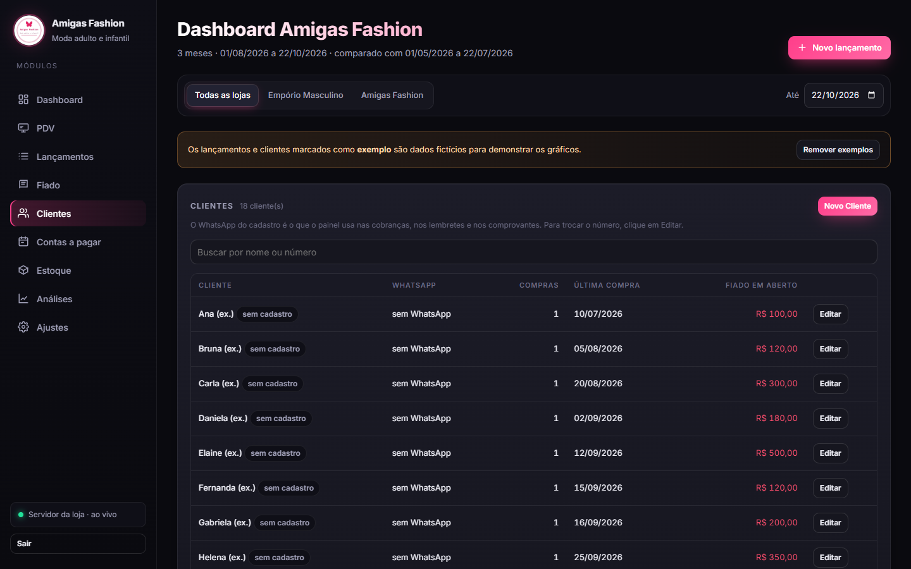

### Análises

Clientes agrupadas por frequência e valor de compra (campeãs, fiéis, novas, esfriando, sumidas), para saber quem chamar de volta.

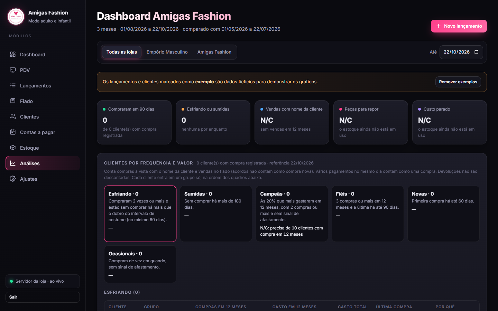

### Lançamentos

Histórico de vendas, saídas e pagamentos, com filtros e exportação para Excel (CSV).

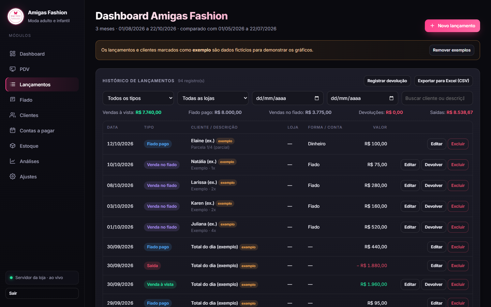

### Contas a pagar

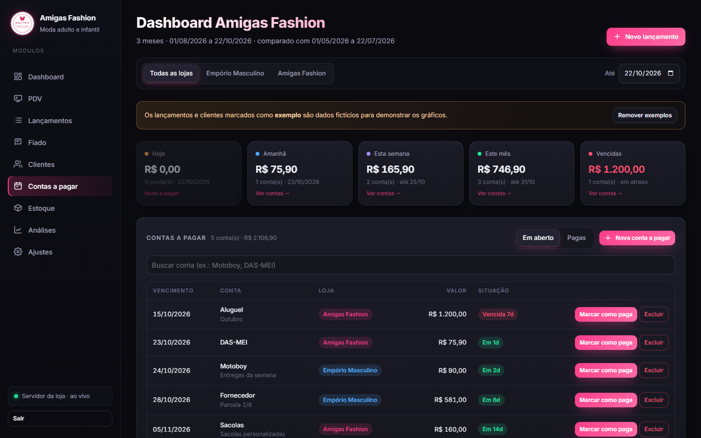

### Ajustes e fechamento do mês

Contas bancárias, metas por loja, backup e exportação, e o fechamento do mês com conferência.

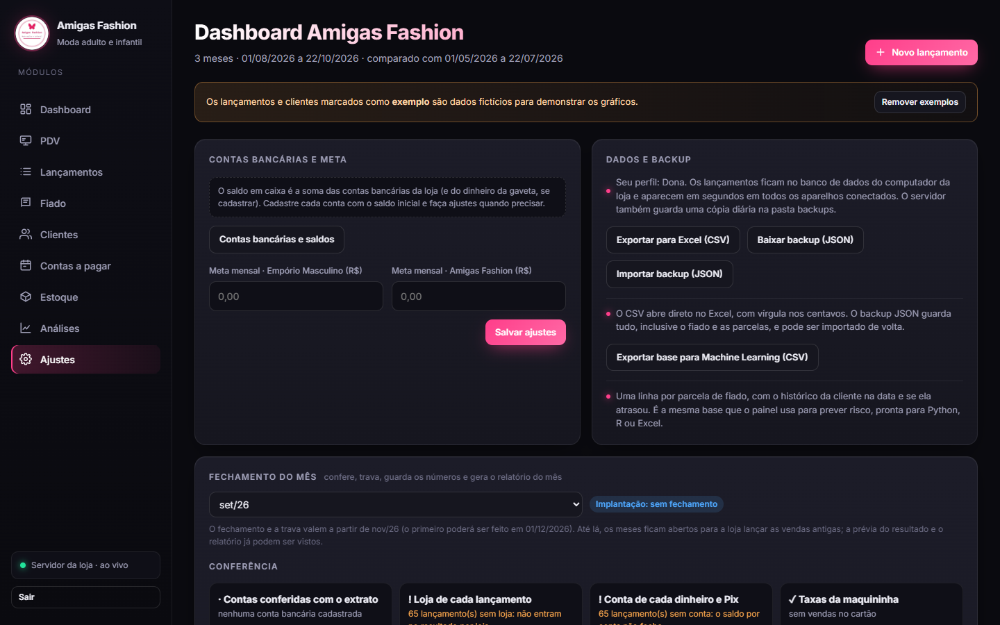

### No celular

<p>
  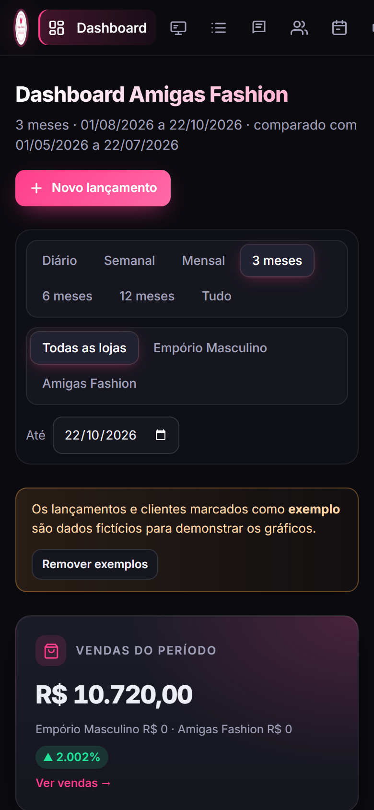
  &nbsp;
  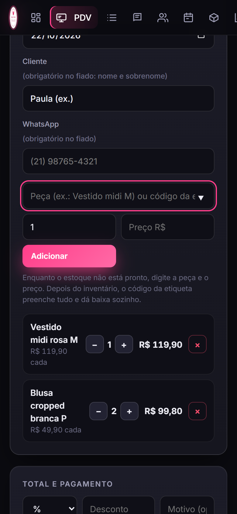
</p>

### Login

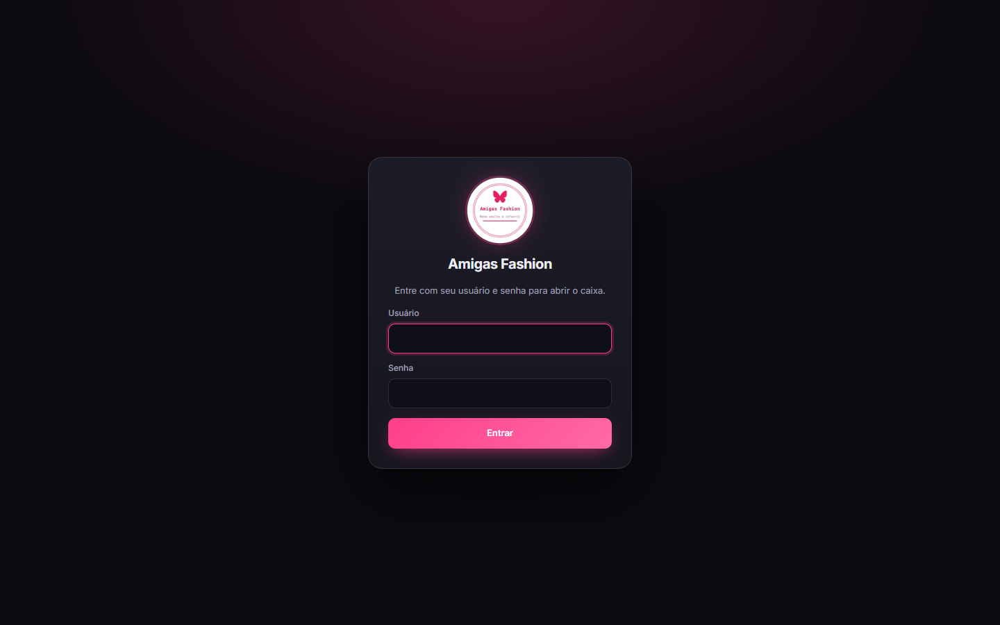

## Funcionalidades

- **PDV**: venda no balcão com carrinho, desconto, pagamento dividido em várias formas e vale-troca.
- **Estoque**: código de etiqueta por loja, custo e preço, margem, movimentações (venda, devolução, perda, ajuste) e etiqueta para imprimir.
- **Lançamentos**: vendas, saídas por categoria e vales de funcionárias.
- **Fiado**: vendas parceladas por cliente, com controle de parcelas pagas, em aberto e atrasadas, risco de inadimplência e cobrança pelo WhatsApp.
- **Clientes**: cadastro com WhatsApp e histórico de compras.
- **Análises**: segmentação das clientes por frequência e valor de compra.
- **Duas lojas**: filtros e metas separados para a loja feminina e a masculina.
- **Contas e saldo**: saldo por conta (Mercado Pago, banco digital, maquininha) e por loja.
- **Contas a pagar**, **meta mensal** e **fechamento do mês**.
- **Gráficos e indicadores** do período, feitos com Chart.js.
- **Login** com usuário e senha (senha com hash PBKDF2 e sessão por cookie).
- **Nada se perde**: banco SQLite em modo WAL, histórico de toda alteração e exclusão (tabela `eventos`), lixeira com restauração e backups diários (`.db` + `.json`) mantidos por 60 dias.
- **Exportação para Machine Learning**: CSV pelo painel e visões SQL (`vw_lancamentos`, `vw_parcelas`, `vw_contas_pagar`) para pandas e Power BI.
- Pode ser instalado na tela inicial do celular, como um app.

## Tecnologias

- **Back-end:** Python 3, só com a biblioteca padrão (`http.server`, `sqlite3`), sem dependências externas.
- **Front-end:** HTML, CSS e JavaScript puro, em um único arquivo (`index.html`).
- **Banco de dados:** SQLite.
- **Gráficos:** [Chart.js](https://www.chartjs.org/).

## Como testar

Requer [Python](https://www.python.org/downloads/) 3.8 ou mais novo. Não há nada para instalar com `pip`.

**1. Baixe o projeto**, de um dos dois jeitos:

- Com Git: `git clone https://github.com/lerouxvinicius/amigas-fashion.git`
- Sem Git: clique no botão verde **Code → Download ZIP** nesta página e extraia o arquivo.

**2. Abra o terminal dentro da pasta do projeto:**

```bash
cd amigas-fashion
```

> No Windows, outro jeito é abrir a pasta extraída no Explorador de Arquivos, clicar na barra de endereço, digitar `cmd` e apertar Enter.

**3. Inicie em modo demonstração**, com dados fictícios:

```bash
python servidor.py --demo
```

> No Windows, se aparecer "python não é reconhecido", use `py servidor.py --demo`. Digite o comando direto no terminal, e não dentro do Python (o prompt `>>>`). Se você estiver no `>>>`, digite `exit()` para sair.

**4. Abra http://localhost:8080** e entre com o usuário `demo` e a senha `demo123`.

Para desligar, aperte `Ctrl+C` no terminal.

### Uso na loja (dados reais)

Rode sem `--demo`: `python servidor.py`. Na primeira execução, o servidor pede para criar o usuário e a senha. O modo demo usa um banco separado (`demo.db`) e nunca mistura dados com o banco real. Atalhos: `iniciar-windows.bat` (Windows) e `iniciar-mac-linux.sh` (Mac/Linux). O passo a passo completo para a loja está em [LEIA-ME.txt](LEIA-ME.txt).

## Dados de exemplo

O arquivo `dados-iniciais.json` tem lançamentos e clientes **fictícios**, para demonstrar o painel. Ele só é carregado quando o banco está vazio. O arquivo `dados-demo.json` acrescenta peças de estoque e contas a pagar fictícias, e só é usado no modo `--demo`. Os dados reais da loja não fazem parte deste repositório.
